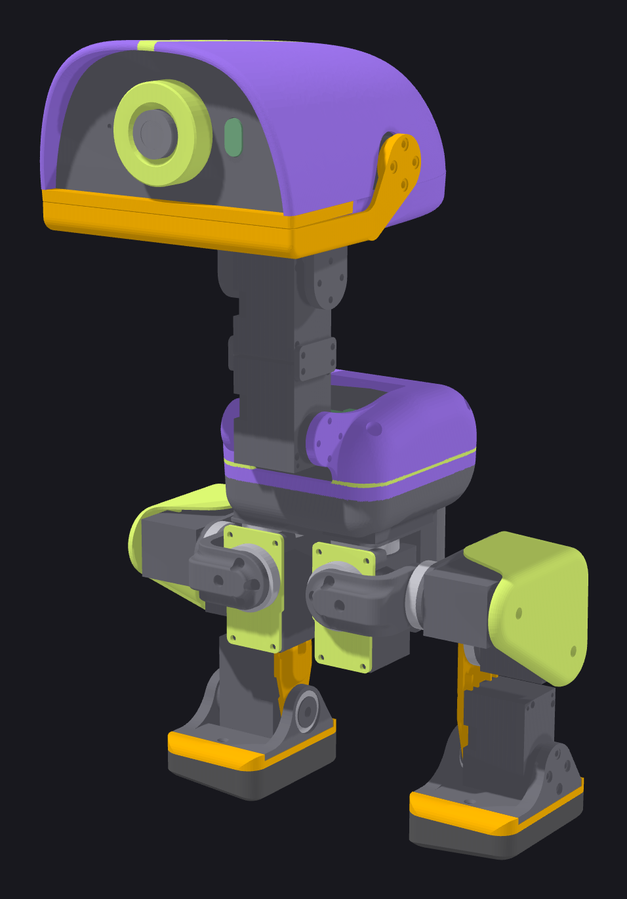
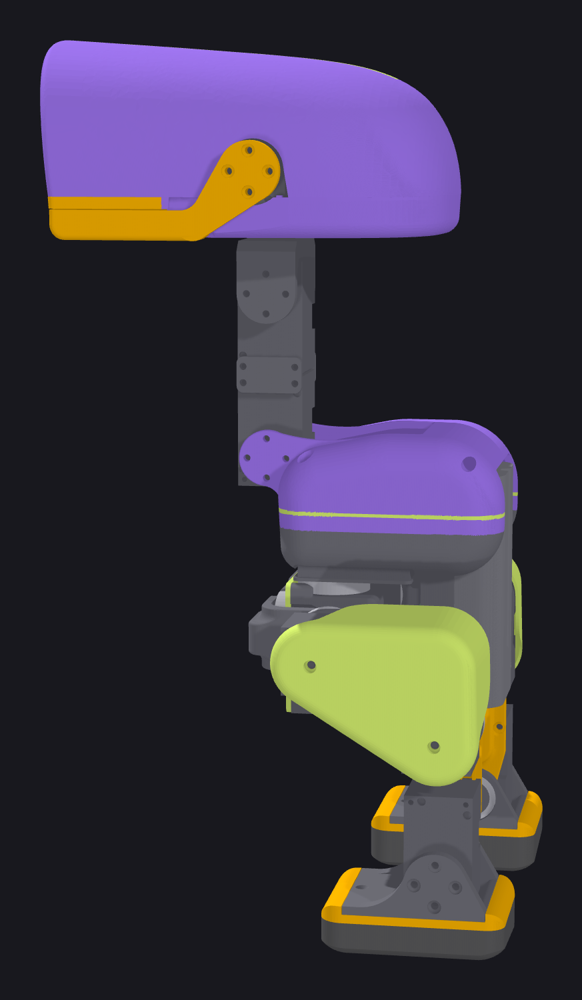
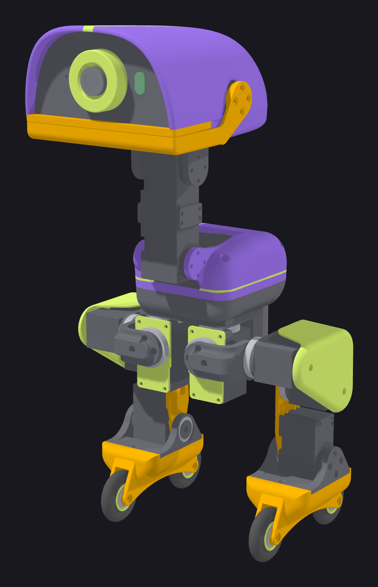

**English** | [Русский](README.ru.md)

<p align="center"></p>

<h1 align="center">kryakva</h1>

<p align="center"><em>Pollen Robotics' Microduck on Feetech HD-1910 servos.</em></p>

<p align="center">
  <a href="hardware/bom.md">Bill of materials</a> ·
  <a href="https://alekswolf.github.io/kryakva/docs/assembly/index.html">Assembly guide</a> ·
  <a href="hardware/wiring.md">Wiring</a> ·
  <a href="software/zero_setup.md">Zero setup</a> ·
  <a href="training/policies/README.md">Policies</a> ·
  <a href="https://discord.gg/8v45FD28s">Discord</a>
</p>

---

A custom duck on 15 HD-1910 servos instead of Dynamixel XL330. All parts are drawn from scratch, the PCB is our own design,
the policies are trained for these servos. Inside: Radxa Zero 3W, camera, rangefinder, microphone and speaker, powered by an NP-F550.

The duck stands up from the floor, walks and turns on commands from a DualSense gamepad.

<table>
  <tr>
    <td width="50%" align="center"></td>
    <td width="50%" align="center"></td>
  </tr>
  <tr>
    <td align="center"><b>On legs.</b> 15 HD-1910 servos, a head on four servos and a beak.</td>
    <td align="center"><b>On rollers.</b> The rollers replace the feet on the same screw.</td>
  </tr>
</table>

The project was made together with the Claude neural network (Anthropic). A human designed and drew the parts. Calculations, policy training,
software and documentation are joint work.

The robot software — Pollen's robotd with our patches for the Feetech bus — is in [software/robotd](software/robotd/README.md).

## Differences from Pollen's Microduck

| | Pollen Microduck | kryakva |
|---|---|---|
| Servos | 15 × Dynamixel XL330-M288-T | 15 × Feetech HD-1910-C001 |
| Servo bus and 5 V | Pollen HAT board | UC-01 board (Zero UART → servo bus) + UBEC 5 V / 3 A |
| Servo power | through the HAT | own PCB: battery → two leg chains and the head, 5 connectors |
| IMU | LSM6DSV16X on the servo bus (imu_to_dxl board) | LSM6DSV16X module on I²C in the trunk |
| Rangefinder | VL53L8CX | VL53L8CX module on I²C |
| Sound | codec on the HAT | MAX98357A amplifier + speaker, I²S microphone |
| Camera | IMX219 with an M12 lens | Radxa Camera 8M 219 (IMX219) |
| Printed parts | Pollen STL for XL330 | own parts for HD-1910 |
| Rollers | Pollen Accessory Pack | printed wheels: rim and TPU tire, MR126ZZ bearings |
| Policies | for XL330 | trained for HD-1910 |

## What is in the repository

```
cad/assembly.step          assembled duck
cad/assembly_rollers.step  assembled duck on rollers
cad/parts.md               list of parts, inserts, bearings and fasteners
cad/calibration_plate.step plate for setting the servo zero
print/                     Bambu Studio profiles
docs/assembly/             assembly guide with a 3D model (index.html)
hardware/                  purchasing, wiring, cables, PCB, servo setup
software/                  Radxa Zero 3W setup, robot software robotd, duck page, servo console
training/                  MJCF models, servo model, ONNX policies, patches to Pollen recipes
docs/datasheets/           manufacturer documents
```

## Assembly

1. Purchasing — [hardware/bom.md](hardware/bom.md), PCB — [hardware/power_board](hardware/power_board/README.md), cables — [hardware/cables.md](hardware/cables.md).
2. Printing — [print/](print/README.md), parts list — [cad/parts.md](cad/parts.md).
3. Servo ID and zero — [hardware/servo_setup.md](hardware/servo_setup.md).
4. Assembly — [assembly guide](https://alekswolf.github.io/kryakva/docs/assembly/index.html), wiring — [hardware/wiring.md](hardware/wiring.md).
5. Zero 3W — [software/zero_setup.md](software/zero_setup.md).

## Training

Recipes — [pollen-robotics/microduck_rl](https://github.com/pollen-robotics/microduck_rl) with patches from [training/patches](training/patches/README.md). Robot models — [training/model](training/model),
servo model — [training/actuators](training/actuators). Ready policies and how to run them — [training/policies/README.md](training/policies/README.md).

## Licenses

Code, configuration and documentation — Apache 2.0. 3D models and print profiles — CC BY-NC-SA 4.0 (non-commercial use).
Details — `LICENSE` and `NOTICE`.

## Acknowledgements

Pollen Robotics (Microduck, training recipes), fanhao375 (servo console), JoyandAI (HD-1910 actuator law for BAM),
Rhoban (BAM, onshape-to-robot), mjlab.
