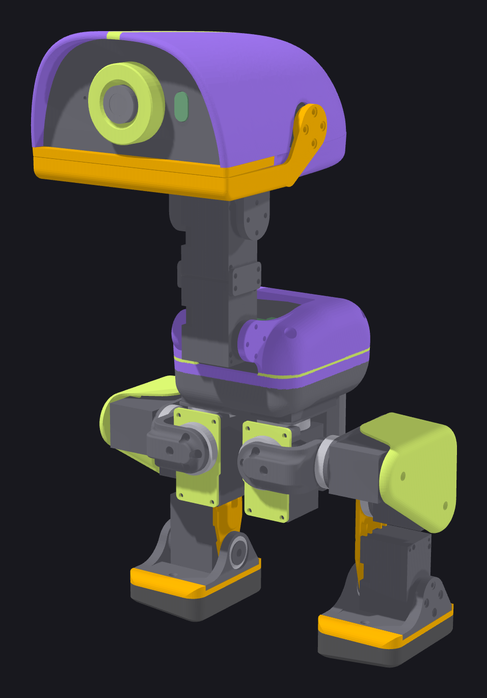
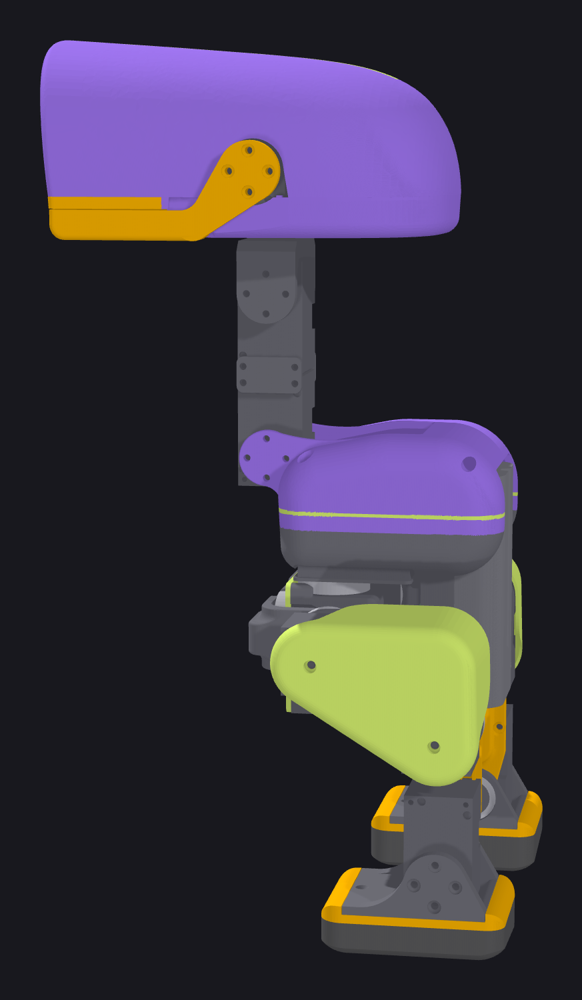
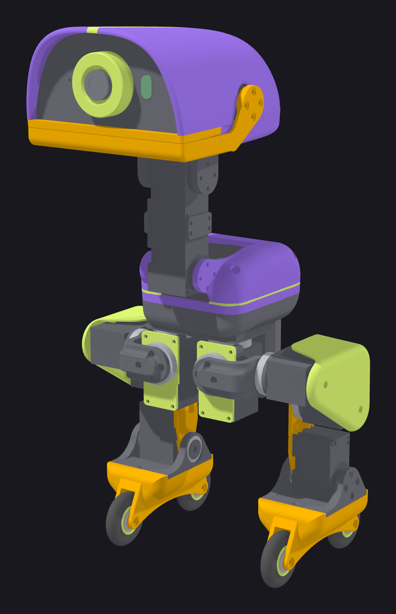

[English](README.md) | **Русский**

<p align="center"></p>

<h1 align="center">kryakva</h1>

<p align="center"><em>Microduck от Pollen Robotics на сервах Feetech HD-1910.</em></p>

<p align="center">
  <a href="hardware/bom.ru.md">Закупка</a> ·
  <a href="https://alekswolf.github.io/kryakva/docs/assembly/index.ru.html">Инструкция сборки</a> ·
  <a href="hardware/wiring.ru.md">Подключение</a> ·
  <a href="software/zero_setup.ru.md">Настройка Zero</a> ·
  <a href="training/policies/README.ru.md">Политики</a> ·
  <a href="https://discord.gg/8v45FD28s">Discord</a>
</p>

---

Своя утка на 15 сервах HD-1910 вместо Dynamixel XL330. Все детали нарисованы с нуля, PCB разведена своя,
политики обучены под эти сервы. Внутри Radxa Zero 3W, камера, дальномер, микрофон и динамик, питание от NP-F550.

Утка встаёт с пола, ходит и поворачивает по командам с геймпада DualSense.

<table>
  <tr>
    <td width="50%" align="center"></td>
    <td width="50%" align="center"></td>
  </tr>
  <tr>
    <td align="center"><b>На ногах.</b> 15 серв HD-1910, голова на четырёх сервах и клюв.</td>
    <td align="center"><b>На роликах.</b> Ролики ставятся вместо стоп на тот же винт.</td>
  </tr>
</table>

Проект сделан в паре с нейросетью Claude (Anthropic). Детали придумывал и рисовал человек. Расчёты, обучение политик,
программы и документация — совместная работа.

Программа робота — robotd Pollen с нашими патчами под шину Feetech — в [software/robotd](software/robotd/README.ru.md).

## Чем отличается от Microduck Pollen

| | Pollen Microduck | kryakva |
|---|---|---|
| Сервы | 15 × Dynamixel XL330-M288-T | 15 × Feetech HD-1910-C001 |
| Шина серв и 5 В | плата Pollen HAT | плата UC-01 (UART Zero → шина серв) + UBEC 5 В / 3 А |
| Питание серв | через HAT | своя PCB: батарея → две цепочки ног и голова, 5 разъёмов |
| IMU | LSM6DSV16X на шине серв (плата imu_to_dxl) | модуль LSM6DSV16X по I²C в туловище |
| Дальномер | VL53L8CX | модуль VL53L8CX по I²C |
| Звук | кодек на HAT | усилитель MAX98357A + динамик, микрофон I²S |
| Камера | IMX219 с объективом M12 | Radxa Camera 8M 219 (IMX219) |
| Печатные детали | STL Pollen под XL330 | свои детали под HD-1910 |
| Ролики | Accessory Pack Pollen | печатные колёса: обод и шина TPU, подшипники MR126ZZ |
| Политики | под XL330 | обучены под HD-1910 |

## Что в репозитории

```
cad/assembly.step          утка в сборе
cad/assembly_rollers.step  утка в сборе на роликах
cad/parts.md               список деталей, вставок, подшипников и крепежа
cad/calibration_plate.step пластина для выставления нуля серв
print/                     профили Bambu Studio
docs/assembly/             инструкция сборки с 3D-моделью (index.html)
hardware/                  закупка, подключение, кабели, PCB, настройка серв
software/                  настройка Radxa Zero 3W, программа робота robotd, страница утки, пульт серв
training/                  модели MJCF, модель сервы, политики ONNX, патчи к рецептам Pollen
docs/datasheets/           документы производителей
```

## Сборка

1. Закупка — [hardware/bom.md](hardware/bom.ru.md), PCB — [hardware/power_board](hardware/power_board/README.ru.md), кабели — [hardware/cables.md](hardware/cables.ru.md).
2. Печать — [print/](print/README.ru.md), список деталей — [cad/parts.md](cad/parts.ru.md).
3. ID и ноль серв — [hardware/servo_setup.md](hardware/servo_setup.ru.md).
4. Сборка — [инструкция сборки](https://alekswolf.github.io/kryakva/docs/assembly/index.ru.html), подключение — [hardware/wiring.md](hardware/wiring.ru.md).
5. Zero 3W — [software/zero_setup.md](software/zero_setup.ru.md).

## Обучение

Рецепты — [pollen-robotics/microduck_rl](https://github.com/pollen-robotics/microduck_rl) с патчами из [training/patches](training/patches/README.ru.md). Модели робота — [training/model](training/model),
модель сервы — [training/actuators](training/actuators). Готовые политики и как их запускать — [training/policies/README.md](training/policies/README.ru.md).

## Лицензии

Код, конфигурация и документация — Apache 2.0. 3D-модели и профили печати — CC BY-NC-SA 4.0 (некоммерческое использование).
Подробно — `LICENSE` и `NOTICE`.

## Благодарности

Pollen Robotics (Microduck, рецепты обучения), fanhao375 (пульт серв), JoyandAI (закон привода HD-1910 для BAM),
Rhoban (BAM, onshape-to-robot), mjlab.
