# What to buy

## Electronics

| Image | Item | Qty | Links | Note |
|---|---|---|---|---|
| [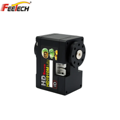](images/hd1910.png) | Servo Feetech HD-1910-C001 | 15 | [Taobao](https://e.tb.cn/h.jiFXhAr7ovPaEK4?tk=MWQs6X9vSL5) · [Amazon](https://www.amazon.com/dp/B0HMX63D8F) | |
| [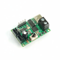](images/uc01.png) | Servo bus board Fashion Star UC-01 | 1 | [Taobao](https://e.tb.cn/h.jiFwfNf3MuBmN11?tk=o4Lp6XkOdsx) · [Fashion Star](https://fashionstar.com.hk/store/product/bus-servo-debug-and-power-board-ruc-01/) | Needs a right-angle pin header, 2.54 mm, single row (one strip is enough for the IMU too) |
| [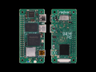](images/zero3w.png) | Radxa Zero 3W, 2 GB, Wi-Fi, with soldered pin header | 1 | [Taobao](https://e.tb.cn/h.j7JmNmOw82iLiDN?tk=8AR46XP2esp) · [Amazon](https://www.amazon.com/dp/B0CZD16K7Q) |  |
| [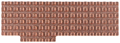](images/heatsink5519a.png) | Heatsink Radxa Heatsink 5519A (AE015A) | 1 | [Amazon](https://a.co/d/03diIFEC) · [AliExpress](https://ali.click/r7clq14) |  |
| [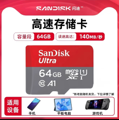](images/microsd.png) | microSD | 1 | [Taobao](https://e.tb.cn/h.j85Izm6DsUi4t4K?tk=10KS6XOTd6f) · [Amazon](https://a.co/d/0dolc4vD) | At least 32 GB, Class 10, A1; a known brand |
| [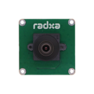](images/camera8m219.png) | Radxa Camera 8M 219 (IMX219) | 1 | [Taobao](https://e.tb.cn/h.jjDNmvN6TM1phZk?tk=sCRU6XPhXNz) · [Amazon](https://a.co/d/07n7ZMUR) · [AliExpress](https://ali.click/xiclq13) |  |
| [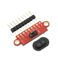](images/vl53l8cx.png) | ToF module VL53L8CX | 1 | [Taobao](https://e.tb.cn/h.j8U1aah6esE5RXJ?tk=FdrX6XPnfe2) · [Amazon](https://a.co/d/0823InEu) · [AliExpress](https://ali.click/yqdlq1u) |  |
| [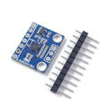](images/lsm6dsv16x.png) | IMU module LSM6DSV16X | 1 | [Taobao](https://e.tb.cn/h.j8U5YFptcCrySUn?tk=t2ZE6XPHRvK) · [AliExpress](https://ali.click/7mflq15) | Needs a right-angle pin header, 2.54 mm, single row |
| [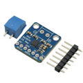](images/max98357a.png) | Amplifier MAX98357A (I²S module) | 1 | [Taobao](https://e.tb.cn/h.j8UhJJzgEulPoit?tk=b12E6XPvxSM) · [Amazon](https://a.co/d/02f99dot) |  |
| [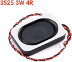](images/speaker3525.png) | Speaker 3525 | 1 | [Taobao](https://e.tb.cn/h.jjxVWPGAZMUroQ5?tk=SgxK6XPzW4y) · [Amazon](https://a.co/d/0j108CcZ) |  |
| [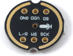](images/ics43434.png) | I²S microphone ICS-43434, round module Ø14 | 1 | [Taobao](https://e.tb.cn/h.jiE7YVTLngNY81j?tk=7FYO6Xlc7BU) · [Amazon](https://a.co/d/028yhDio) |  |
| [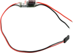](images/ubec.png) | UBEC 5 V / 3 A | 1 | [Taobao](https://e.tb.cn/h.jjxQE5Cn4MRk7EI?tk=GBh76XlV9qC) · [Amazon](https://a.co/d/03DJHB3f) |  |
| [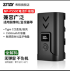](images/npf550c.png) | Battery ZITAY NP-F550C | 1 (+1) | [Taobao](https://e.tb.cn/h.j7rLXlL8eB01cEr?tk=1MW86XlUBJe) · [ZITAY](https://www.zitay.net/ZITAY-NP-F550C-with-USB-C-compatible-with-Sony-NP-F550-570-530-Replacement-Battery-p4583600.html) | Do not buy OEM |
| [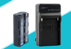](images/npf_charger.png) | NP-F charger (the cheapest one) | 1 | [Taobao](https://e.tb.cn/h.jiErzKacAHp8BjD?tk=MSM76Xl99Fq) · [Amazon](https://a.co/d/0hta8lpl) | Donor of the battery contacts: two strips with self-tapping screws |
|  | Switch-style Bluetooth gamepad, no brand (shows as "Pro Controller" in Bluetooth) | 1 | [Taobao](https://e.tb.cn/h.j7Ic9Kq3uvwCz8P?tk=svjC6XlH4Iz) · [Amazon](https://a.co/d/0cNeZ9oY) | Supported: Xbox Wireless Controller, Sony DualSense, no-brand Switch-style gamepads ("Pro Controller") |
| [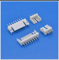](images/amp20_header.png) | Header AMP 2.0-3P, straight (CJT A2007WV-3P or compatible) | 10 | [Taobao](https://e.tb.cn/h.j85Rf9GkH3BzpQW?tk=haqW6XlzM5g) · [Octopart](https://octopart.com/part/cjt-connectors/A2007WV-3P) |  |
| | Silicone wires 24 AWG, assorted colors, and Dupont terminals — or ready-made Dupont wires | — | |  |
| | Silicone wires 16 (18) AWG, red and black | 5 cm | |  |

## Servo bus cables

Cables included with the servos: 9 pcs. Order or make the following:

| Item | Qty |
|---|---|
| AMP 2.0-3P cable, double-ended, 4 cm | 3 |
| AMP 2.0-3P cable, double-ended, 6 cm | 3 |
| AMP 2.0-3P cable, double-ended, 20 cm | 2 |
| AMP 2.0-3P cable, double-ended, 25 cm | 1 |
| AMP 2.0-3P cable, connector on one end, 9 cm | 1 |

## PCB order

| Item | Qty | Files | Note |
|---|---|---|---|
| PCB | 1 | [Gerber and drawing](power_board/README.md) | Trunk power board |

## Mechanics

| Image | Item | Qty | Note |
|---|---|---|---|
| [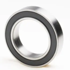](images/mr2216_2rs.png) | Bearing MR2216-2RS, 16 × 22 × 4 | 11 | Rubber seals on both sides |
| [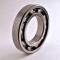](images/bearing_6700.png) | Bearing 6700 open, 10 × 15 × 3 | 3 | No shields |
| [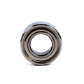](images/mr126zz.png) | Bearing MR126ZZ, 6 × 12 × 4 | 8 | Metal shields on both sides |
| [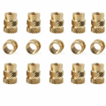](images/heat_insert.png) | Heat-set insert M2 × 4 × Ø3 | 13 | Double knurl in opposite directions |
|  | Heat-set insert M2 × 3 × Ø3.2 | 9 | Double knurl in opposite directions |
| [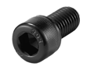](images/screw_hex.png) | Screw M2 × 4 hex socket | 32 |  |
|  | Screw M2 × 6 hex socket | 87 |  |
|  | Screw M2 × 8 hex socket | 7 |  |
|  | Screw M2 × 12 hex socket | 4 |  |
| [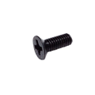](images/screw_csk.png) | Screw M2 × 6 countersunk | 2 |  |
|  | Screw M2.5 × 6 | 4 |  |
|  | Screw M2.5 × 6 countersunk | 2 |  |
|  | Screw M2.5 × 14 | 4 |  |
| [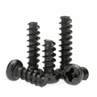](images/self_tap.png) | Self-tapping screw M2.3 × 4 | 4 |  |
|  | Self-tapping screw M2.3 × 6 | 2 |  |
| | Double-sided adhesive tape on paper backing (soft beak inserts) | — |  |
| | Nylon cable tie, the shortest | 2 |  |

## Plastic

Bambu Lab PLA Basic (rigid parts), Bambu Lab TPU (soles, soft beak parts, roller tires): TPU 85A — for the X2D profile with the 0.6 nozzle, TPU 90A — for the P2S profile with the 0.4 nozzle.

Clamp `zero clamp`: Eryone ASA-CF — in the X2D profile, Bambu Lab ASA — in the P2S profile. Bambu Lab PETG Basic — support interface layer in the X2D profile with the 0.4 nozzle.
