# Что купить

## Электроника

| Картинка | Что | Шт. | Ссылки | Примечание |
|---|---|---|---|---|
|  | Серва Feetech HD-1910-C001 | 15 | [Taobao](https://e.tb.cn/h.jiFXhAr7ovPaEK4?tk=MWQs6X9vSL5) · [Amazon](https://www.amazon.com/dp/B0HMX63D8F) | |
| [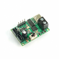](images/uc01.png) | Плата шины серв Fashion Star UC-01 | 1 | [Taobao](https://e.tb.cn/h.jiFwfNf3MuBmN11?tk=o4Lp6XkOdsx) · [Fashion Star](https://fashionstar.com.hk/store/product/bus-servo-debug-and-power-board-ruc-01/) | Нужна угловая гребёнка 2.54 мм, однорядная (одной полоски хватает и на IMU) |
| [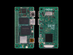](images/zero3w.png) | Radxa Zero 3W, 2 ГБ, Wi-Fi, с запаянной гребёнкой | 1 | [Taobao](https://e.tb.cn/h.j7JmNmOw82iLiDN?tk=8AR46XP2esp) · [Amazon](https://www.amazon.com/dp/B0CZD16K7Q) |  |
| [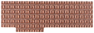](images/heatsink5519a.png) | Радиатор Radxa Heatsink 5519A (AE015A) | 1 | [Amazon](https://a.co/d/03diIFEC) · [AliExpress](https://ali.click/r7clq14) |  |
|  | microSD | 1 | [Taobao](https://e.tb.cn/h.j85Izm6DsUi4t4K?tk=10KS6XOTd6f) · [Amazon](https://a.co/d/0dolc4vD) | Не меньше 32 ГБ, Class 10, A1; известный бренд |
| [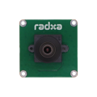](images/camera8m219.png) | Radxa Camera 8M 219 (IMX219) | 1 | [Taobao](https://e.tb.cn/h.jjDNmvN6TM1phZk?tk=sCRU6XPhXNz) · [Amazon](https://a.co/d/07n7ZMUR) · [AliExpress](https://ali.click/xiclq13) |  |
| [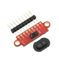](images/vl53l8cx.png) | Модуль ToF VL53L8CX | 1 | [Taobao](https://e.tb.cn/h.j8U1aah6esE5RXJ?tk=FdrX6XPnfe2) · [Amazon](https://a.co/d/0823InEu) · [AliExpress](https://ali.click/yqdlq1u) |  |
| [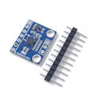](images/lsm6dsv16x.png) | Модуль IMU LSM6DSV16X | 1 | [Taobao](https://e.tb.cn/h.j8U5YFptcCrySUn?tk=t2ZE6XPHRvK) · [AliExpress](https://ali.click/7mflq15) | Нужна угловая гребёнка 2.54 мм, однорядная |
| [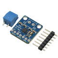](images/max98357a.png) | Усилитель MAX98357A (модуль I²S) | 1 | [Taobao](https://e.tb.cn/h.j8UhJJzgEulPoit?tk=b12E6XPvxSM) · [Amazon](https://a.co/d/02f99dot) |  |
| [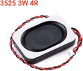](images/speaker3525.png) | Динамик 3525 | 1 | [Taobao](https://e.tb.cn/h.jjxVWPGAZMUroQ5?tk=SgxK6XPzW4y) · [Amazon](https://a.co/d/0j108CcZ) |  |
| [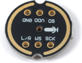](images/ics43434.png) | Микрофон I²S ICS-43434, круглый модуль Ø14 | 1 | [Taobao](https://e.tb.cn/h.jiE7YVTLngNY81j?tk=7FYO6Xlc7BU) · [Amazon](https://a.co/d/028yhDio) |  |
| [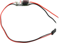](images/ubec.png) | UBEC 5 В / 3 А | 1 | [Taobao](https://e.tb.cn/h.jjxQE5Cn4MRk7EI?tk=GBh76XlV9qC) · [Amazon](https://a.co/d/03DJHB3f) |  |
| [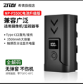](images/npf550c.png) | Аккумулятор ZITAY NP-F550C | 1 (+1) | [Taobao](https://e.tb.cn/h.j7rLXlL8eB01cEr?tk=1MW86XlUBJe) · [ZITAY](https://www.zitay.net/ZITAY-NP-F550C-with-USB-C-compatible-with-Sony-NP-F550-570-530-Replacement-Battery-p4583600.html) | Не брать OEM |
| [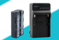](images/npf_charger.png) | Зарядное устройство NP-F (самое дешёвое) | 1 | [Taobao](https://e.tb.cn/h.jiErzKacAHp8BjD?tk=MSM76Xl99Fq) · [Amazon](https://a.co/d/0hta8lpl) | Донор контактов батареи: две полоски с саморезами |
|  | Геймпад Bluetooth в стиле Switch, без бренда (в Bluetooth — «Pro Controller») | 1 | [Taobao](https://e.tb.cn/h.j7Ic9Kq3uvwCz8P?tk=svjC6XlH4Iz) · [Amazon](https://a.co/d/0cNeZ9oY) | Поддерживаются: Xbox Wireless Controller, Sony DualSense, геймпады в стиле Switch без бренда («Pro Controller») |
| [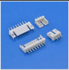](images/amp20_header.png) | Вилка AMP 2.0-3P, прямая (CJT A2007WV-3P или совместимая) | 10 | [Taobao](https://e.tb.cn/h.j85Rf9GkH3BzpQW?tk=haqW6XlzM5g) · [Octopart](https://octopart.com/part/cjt-connectors/A2007WV-3P) |  |
| | Провода силиконовые 24 AWG, набор цветов, и клеммы Dupont — или готовые провода Dupont | — | |  |
| | Провода силиконовые 16 (18) AWG, красный и чёрный | 5 см | |  |

## Кабели шины серв

Комплектные кабели — 9 шт., заказать или изготовить следующие:

| Что | Шт. |
|---|---|
| Кабель AMP 2.0-3P, двусторонний, 4 см | 3 |
| Кабель AMP 2.0-3P, двусторонний, 6 см | 3 |
| Кабель AMP 2.0-3P, двусторонний, 20 см | 2 |
| Кабель AMP 2.0-3P, двусторонний, 25 см | 1 |
| Кабель AMP 2.0-3P, с одной вилкой, 9 см | 1 |

## Заказ PCB

| Что | Шт. | Файлы | Примечание |
|---|---|---|---|
| PCB | 1 | [гербер и чертёж](power_board/README.ru.md) | Плата питания туловища |

## Механика

| Картинка | Что | Шт. | Примечание |
|---|---|---|---|
| [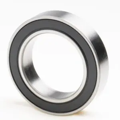](images/mr2216_2rs.png) | Подшипник MR2216-2RS, 16 × 22 × 4 | 11 | Резиновые пыльники с двух сторон |
| [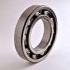](images/bearing_6700.png) | Подшипник 6700 открытый, 10 × 15 × 3 | 3 | Без пыльников |
| [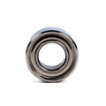](images/mr126zz.png) | Подшипник MR126ZZ, 6 × 12 × 4 | 8 | Металлические пыльники с двух сторон |
| [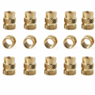](images/heat_insert.png) | Термовставка M2 × 4 × Ø3 | 13 | Двойная накатка в разные стороны |
|  | Термовставка M2 × 3 × Ø3.2 | 9 | Двойная накатка в разные стороны |
| [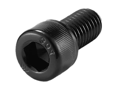](images/screw_hex.png) | Винт M2 × 4 под шестигранник | 32 |  |
|  | Винт M2 × 6 под шестигранник | 87 |  |
|  | Винт M2 × 8 под шестигранник | 7 |  |
|  | Винт M2 × 12 под шестигранник | 4 |  |
| [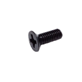](images/screw_csk.png) | Винт M2 × 6 потайной | 2 |  |
|  | Винт M2.5 × 6 | 4 |  |
|  | Винт M2.5 × 6 потайной | 2 |  |
|  | Винт M2.5 × 14 | 4 |  |
| [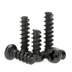](images/self_tap.png) | Саморез M2.3 × 4 | 4 |  |
|  | Саморез M2.3 × 6 | 2 |  |
| | Двусторонняя клейкая лента на бумажной основе (мягкие вставки клюва) | — |  |
| | Хомут нейлоновый, самый короткий | 2 |  |

## Пластик

Bambu Lab PLA Basic (жёсткие детали), Bambu Lab TPU (подошвы, мягкие части клюва, шины роликов): TPU 85A — для профиля X2D с соплом 0.6, TPU 90A — для профиля P2S с соплом 0.4.

Прижим `zero clamp`: Eryone ASA-CF — в профиле X2D, Bambu Lab ASA — в профиле P2S. Bambu Lab PETG Basic — контактный слой поддержек в профиле X2D с соплом 0.4.

