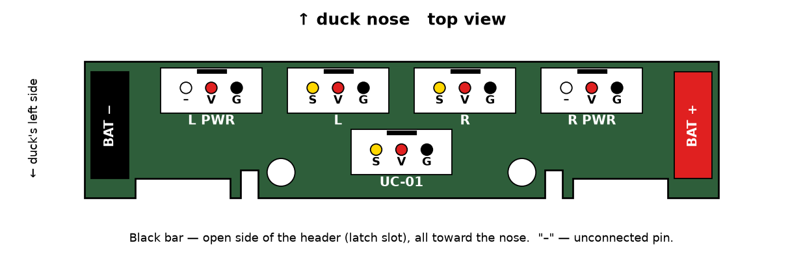
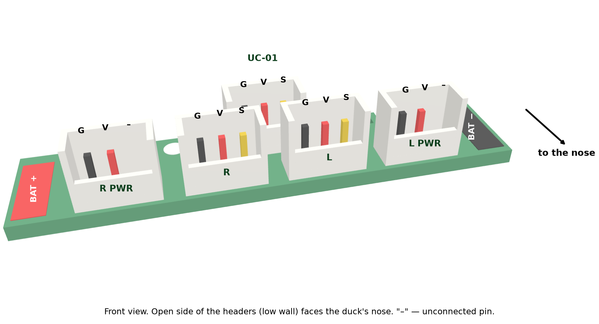

# PCB

Distributes battery power to the servos and UC-01. Sits on the upper tabs of `power_support` above the hip servos, fastened with two
M2×8 screws (head ≤ 3.8 mm). Files: Gerber [power_board_gerber.zip](power_board_gerber.zip), KiCad project `power_board.kicad_*`, drawing [power_board_drawing.png](power_board_drawing.png).

## Connectors

The headers face the front of the duck with their open side. Pins are shown in the picture:

| Connector | To | Pins |
|---|---|---|
| UC-01 | port 2 of the UC-01 board (cable No. 12) | S V G |
| L / R | start of the left / right leg chain (cable No. 1) | S V G |
| L PWR / R PWR | end of the leg chain, power from the other side (cable No. 6) | V G (S without copper) |
| BAT− / BAT+ | flat pads 3 × 8.5 mm: on each, a battery contact and the head power wire (cable No. 13), one after the other | — |

BAT− on the left, BAT+ on the right (top view).

## PCB order

| Parameter | Value |
|---|---|
| Size | 50.0 × 10.8 mm, 2 layers |
| Thickness | 1.6 mm |
| Copper | 1 oz |
| Surface finish | HASL lead-free |
| Holes | vias 0.40; header pins 0.90; mounting 2.20 non-plated |
| Quantity | minimum batch |

## Parts

| Item | Qty per duck | Note |
|---|---|---|
| Header CJT A2007WV-3P, 2.0 mm pitch, vertical | 5 | mating part: A2007H-3P housing, as on the servo cables |
| Screw M2×8 hex socket, head ≤ 3.8 | 2 | fastens the PCB to the power_support tabs |
| Silicone wires 16 (18) AWG, red and black | 5 cm | battery contacts → BAT− / BAT+ |

The NP-F550 battery contacts are two bent strips from the charger, each on one self-tapping screw, with the wire soldered on.
