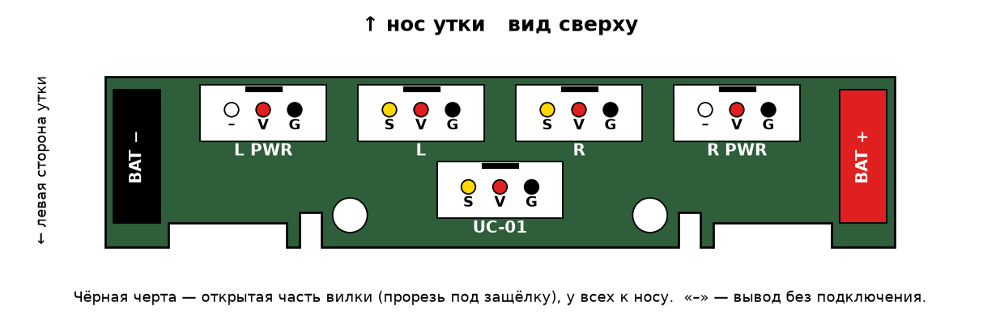
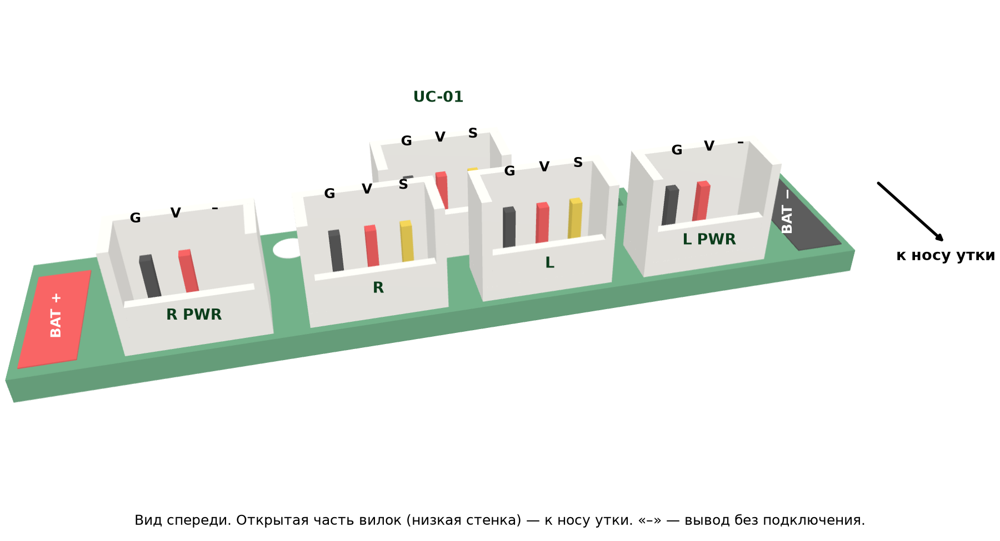

# PCB

Раздаёт питание батареи на сервы и UC-01. Лежит на верхних лапках `power_support` над сервами бёдер, крепится двумя
винтами M2×8 (шляпка ≤ 3.8 мм). Файлы: гербер [power_board_gerber.zip](power_board_gerber.zip), проект KiCad `power_board.kicad_*`, чертёж [power_board_drawing.png](power_board_drawing.png).

## Разъёмы

Вилки стоят открытой частью к переду утки. Контакты — на картинке:

| Разъём | Куда | Контакты |
|---|---|---|
| UC-01 | порт 2 платы UC-01 (кабель № 12) | S V G |
| L / R | начало цепочки левой / правой ноги (кабель № 1) | S V G |
| L PWR / R PWR | конец цепочки ноги, питание со второй стороны (кабель № 6) | V G (S без меди) |
| BAT− / BAT+ | плоские площадки 3 × 8.5 мм: на каждую — контакт батареи и провод питания головы (кабель № 13), друг за другом | — |

BAT− слева, BAT+ справа (вид сверху).

## Заказ PCB

| Параметр | Значение |
|---|---|
| Размер | 50.0 × 10.8 мм, 2 слоя |
| Толщина | 1.6 мм |
| Медь | 1 oz |
| Покрытие | HASL lead-free |
| Отверстия | переходы 0.40; выводы вилок 0.90; крепёж 2.20 без металлизации |
| Количество | минимальная партия |

## Детали

| Что | Шт. на утку | Примечание |
|---|---|---|
| Вилка CJT A2007WV-3P, шаг 2.0 мм, вертикальная | 5 | ответная часть — корпус A2007H-3P, как на кабелях серв |
| Винт M2×8 под шестигранник, шляпка ≤ 3.8 | 2 | крепление PCB к лапкам power_support |
| Провода силиконовые 16 (18) AWG, красный и чёрный | 5 см | контакты батареи → BAT− / BAT+ |

Контакты батареи NP-F550 — две гнутые полоски из зарядного устройства, каждая на одном саморезе, провод припаян.
